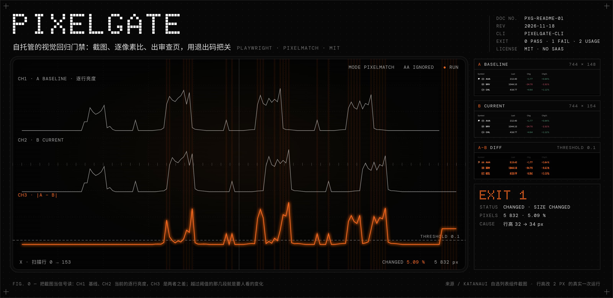
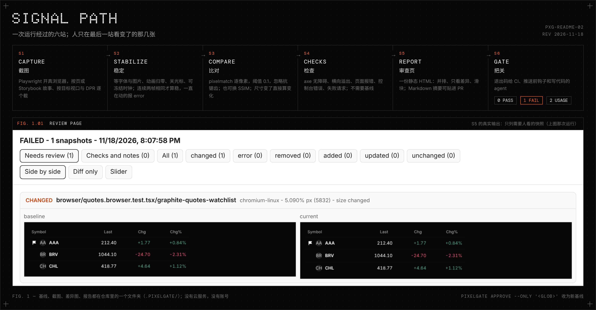

# pixelgate

[English](README.md) · 中文



自托管的视觉回归门禁。MIT 许可，没有云服务，不用注册账号。

pixelgate 用真浏览器（Playwright）渲染你的页面或 Storybook 故事，跟提交进仓库的基线逐像素比，写出一份静态审查页；有变化就以非 0 退出。这个退出码就是门禁：给 CI 用，给推送前的钩子用，也给自己检查界面改动的 coding agent 用。

## 为什么要它

前端审查慢，是因为每次改动后都得有人把每一屏看一遍。pixelgate 替人去看：人（或 agent）只需要看真正变了的那几张，基线和当前并排放，变化的像素标出来。

Happo 这类托管服务做得很好，但渲染集群、比对引擎和审查界面都是闭源的。pixelgate 全在本地：基线在你的仓库里，报告就是一个装着 PNG 和一个 HTML 的文件夹。



## 安装

```bash
pnpm add -D pixelgate-cli playwright
pnpm exec playwright install chromium   # 要测 firefox / webkit 再装它们
```

npm 包名是 `pixelgate-cli`，装好后的命令叫 `pixelgate`。`playwright` 是 peer 依赖：pixelgate 用的是你项目里那份 Playwright，浏览器版本始终对得上。需要 Node 22.18+ 或 23.6+，`pixelgate.config.ts` 不用先编译就能读。

## 配置

项目根目录放 `pixelgate.config.ts`：

```ts
import { defineConfig } from 'pixelgate-cli';

export default defineConfig({
  targets: {
    desktop: { browser: 'chromium', viewport: '1280x720' },
    phone: { device: 'Pixel 7' },
  },
  pages: [
    { name: 'home', url: 'http://localhost:5173/' },
    { name: 'settings-form', url: 'http://localhost:5173/settings', selector: 'form' },
  ],
  storybook: { url: 'http://localhost:6006' },
  threshold: 0.1,
  failOn: ['changed', 'error'],
});
```

## 用法

```bash
pixelgate run                    # 截图、比对、出报告；门禁不过退出码 1
pixelgate run --only 'button--*' # 只跑匹配的快照（改了哪个件就只查哪个）
pixelgate approve --only '<glob>'# 把看过的变化收为新基线
pixelgate summary                # 上次报告的 Markdown，贴进 PR 评论
pixelgate run --json             # 报告 JSON 打到 stdout，给脚本与 agent 读
```

退出码：`0` 通过，`1` 出现了 `failOn` 里列的状态或检查发现，`2` 用法或配置写错。

## 还能做什么

| 能力 | 一句话 |
| --- | --- |
| 稳定截图 | 等字体与图片、动画归零、关光标、可冻结时钟；连续两帧一样才算稳，一直在动的报 `error` 而不是随机 `changed` |
| 比对方式 | 默认 pixelmatch（逐像素，阈值 0.1，忽略抗锯齿）；也可以换 SSIM，或自己注册 |
| 检查 | axe 无障碍、横向溢出、页面报错、控制台错误、失败请求；不需要基线，列进 `failOn` 才拦 |
| ARIA 快照 | 把无障碍树存成 `.aria.yml`，跟截图一起当基线比 |
| 接入方式 | 独立 CLI；Vite 插件；Vitest 浏览器模式的 `toMatchScreenshot`；Playwright Test 的 reporter |
| 探索 | `pixelgate explore`：随机点击和输入，按 LTL 性质找没想到的坏状态（引擎是 Bombadil） |
| CI | 本仓库就是一个 GitHub Action：跑门禁、上传报告、写 job 摘要、在 PR 上维护一条评论 |

每一项的细节和参数见英文 [README](README.md)。

## 给 coding agent

包里带了一份 agent skill，讲怎么只查改了的、怎么读报告、怎么逐张认可基线：

```bash
pixelgate skill                 # 打印
pixelgate skill install         # 写到 .claude/skills/pixelgate/SKILL.md（Claude Code）
```

升级 pixelgate 后重跑一次 `skill install`，agent 手里的说明就跟 CLI 对得上。

## 许可

MIT。借鉴与致谢见英文 README 的 Prior art 一节。
